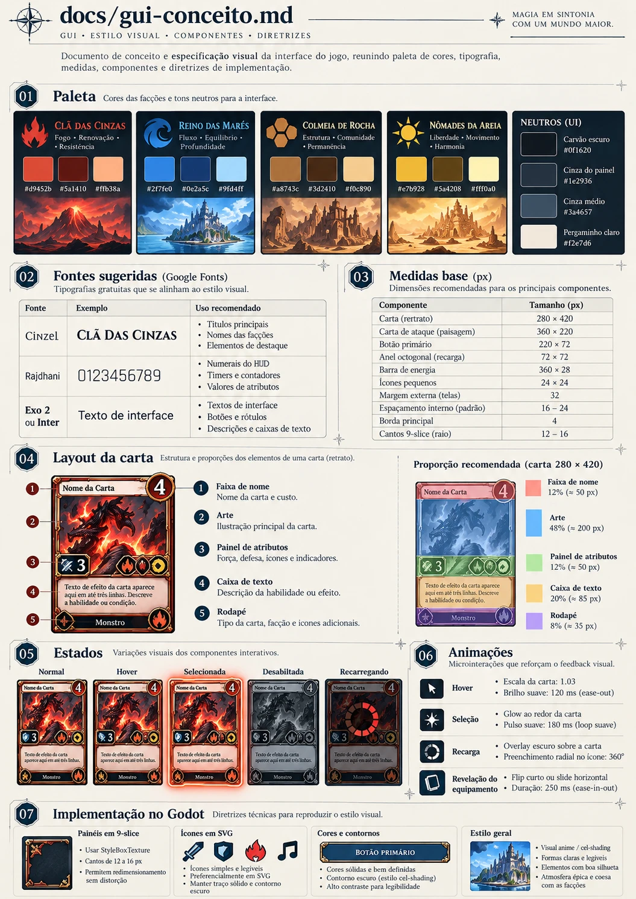
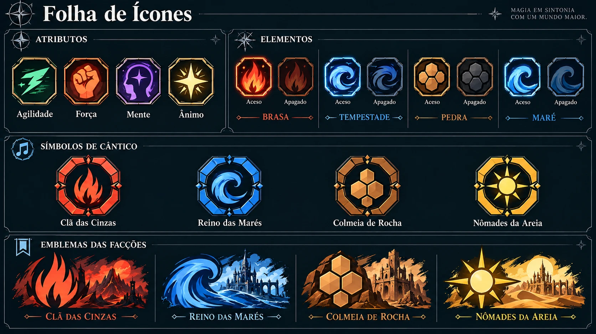
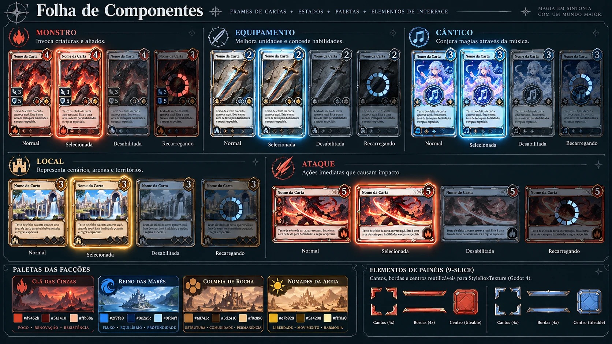
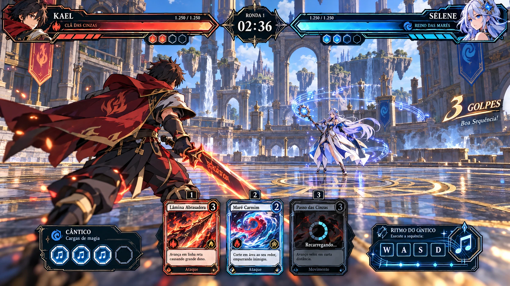
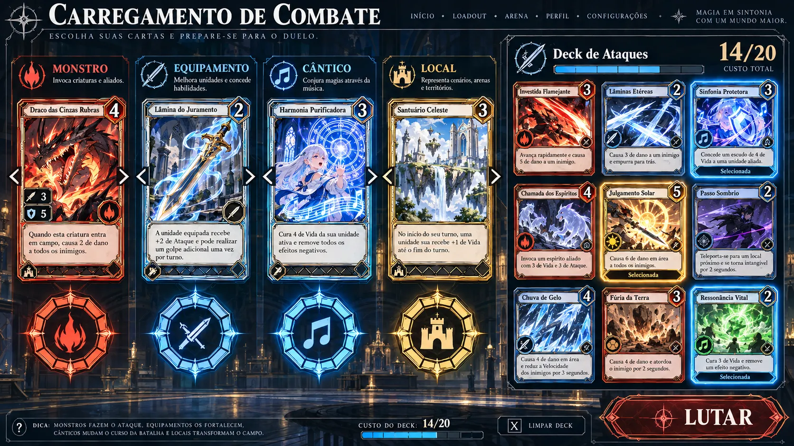

# GUI: conceito e especificação visual

Conceitos gerados no Codex (pasta [`gui-conceito/`](gui-conceito/)) e como cada parte foi implementada no protótipo Godot.

| Especificação | Ícones | Componentes |
|---|---|---|
|  |  |  |

| HUD da luta | Loadout |
|---|---|
|  |  |

## 1. Paleta

| Facção | Principal | Escura | Clara | Marca |
|---|---|---|---|---|
| Clã das Cinzas | `#d9452b` | `#5a1410` | `#ffb38a` | chamas |
| Reino das Marés | `#2f7fe0` | `#0e2a5c` | `#9fd4ff` | onda |
| Colmeia de Rocha | `#a8743c` | `#3d2410` | `#f0c890` | favo hexagonal |
| Nômades da Areia | `#e7b928` | `#5a4208` | `#fff0a0` | sol |

Neutros: carvão `#0f1620`, painel `#1e2936`, cinza médio `#3a4657`, pergaminho `#f2e7d6`, ouro `#e8b75a`.
No código: `prototipo/scripts/ui/tema.gd` e `prototipo/data/faccoes.json`.

## 2. Fontes (Google Fonts, licença OFL, em `prototipo/fontes/`)

| Fonte | Uso |
|---|---|
| **Cinzel** Bold | títulos, nomes de carta e de facção |
| **Rajdhani** Bold | números (HUD, atributos, custos, cronômetro) |
| **Exo 2** Medium/Bold | textos, botões, descrições |

## 3. Medidas (base 1920x1080)

| Componente | Tamanho |
|---|---|
| Carta retrato (Monstro, Equipamento, Cântico, Local) | 280 × 420 |
| Carta de Ataque | 240 × 300 (exibida a 180 × 225 no deck e 200 × 250 na mão) |
| Borda principal | 4–5 px, cantos de 16 px |
| Margem externa das telas | 32 px |

A resolução base do projeto passou a ser **1920x1080** (`stretch = canvas_items`). A janela abre em 1280x720 e a interface escala junto.

## 4. Layout da carta

1. **Faixa de nome** (pergaminho) + **selo** circular dourado (custo do ataque, cargas de Cântico do monstro, elemento do equipamento ou iniciativa do local).
2. **Arte**: o monstro é o **modelo 3D em tempo real** com cel shading, renderizado num `SubViewport`. Os outros tipos usam arte procedural: ícone do equipamento, símbolo do Cântico sobre uma pauta musical, paisagem da arena, glifo do arquétipo do ataque.
   *Arte final:* coloque `prototipo/arte/cartas/<id>.png` e ela substitui a procedural automaticamente.
3. **Painel de atributos**: chips octogonais com ícone e valor.
4. **Caixa de texto** (pergaminho): passiva, descrição ou condição do ataque.
5. **Rodapé**: tipo da carta + marca.

## 5. Estados

| Estado | Implementação |
|---|---|
| Normal | moldura na cor da facção ou do elemento |
| Hover | escala 1.03 + brilho suave |
| Selecionada | brilho pulsante + fita "Selecionada" no rodapé |
| Desabilitada | véu escuro por cima (ex.: atordoado ou cantando) |
| Recarregando | véu escuro + anel radial de progresso + "Recarregando..." |

## 6. Ícones e símbolos

- **Atributos** em chip octogonal: Agilidade (raio verde), Força (punho laranja), Mente (cabeça com estrela roxa), Ânimo (estrela dourada).
- **Elementos** aceso/apagado: Brasa (chama), Tempestade (espiral), Pedra (favo de hexágonos), Maré (onda).
- **Símbolo de Cântico**: anel octogonal chanfrado, com 4 cravos dourados e a marca da facção. Aparece embaixo das cartas no loadout, nas cargas da HUD e no painel de ritmo.

Tudo é desenhado com vetores em `prototipo/scripts/ui/icones.gd`. Para trocar por SVG final, mantenha os mesmos nomes de função.

## 7. Visual 3D "anime"

- `prototipo/shaders/toon.gdshader`: cel shading em 2 tons com sombra puxada para o roxo, brilho de borda (rim light) e especular chapado.
- `prototipo/shaders/contorno.gdshader`: contorno escuro por casco invertido, com espessura constante em pixels.
- Impactos com onda de choque, olhos grandes com brilho, contador de combo "N GOLPES".
