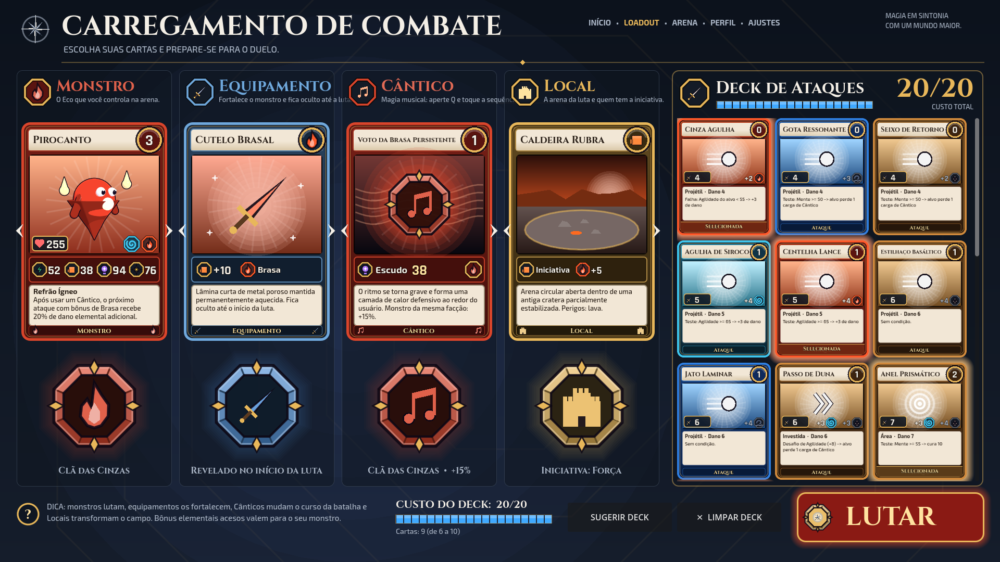
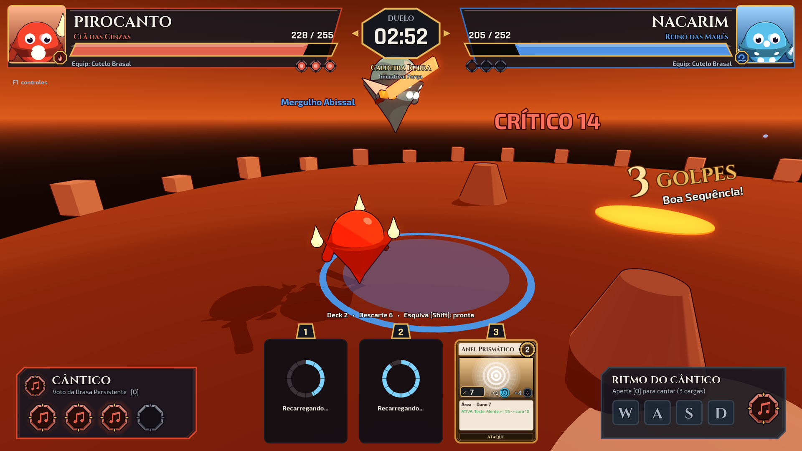
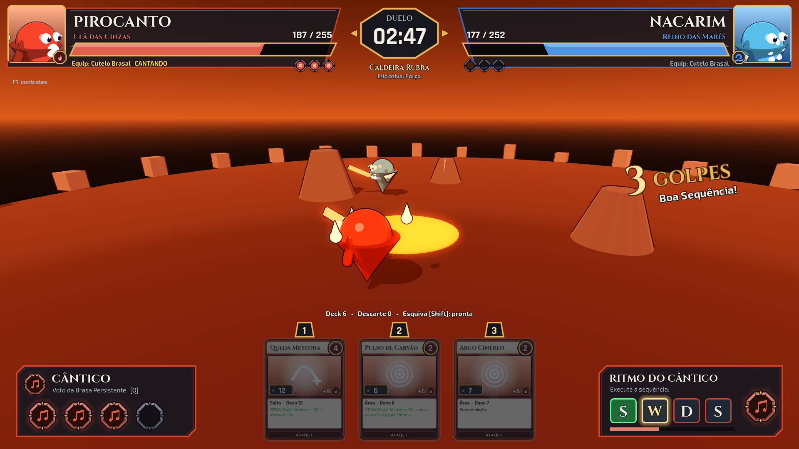

# Ecos de Aetheris: protótipo de arena 3D (Godot 4)

Protótipo jogável do conceito em [`../docs/conceito-jogo-3d.md`](../docs/conceito-jogo-3d.md): um jogo de **ação 3D** em que as **cartas são o loadout**, como no anime *Chaotic*. Elas definem o monstro que você controla, o equipamento que ele carrega, o cenário da luta, o Cântico (magia musical) e os golpes que aparecem na sua mão durante o combate.

- Visual: **cel shading de anime com contorno**, cartas e HUD seguindo o conceito de GUI em [`../docs/gui-conceito.md`](../docs/gui-conceito.md).
- Conteúdo: **12 monstros, 24 ataques, 8 equipamentos, 6 Cânticos e 6 arenas** do mundo de Teralume ([`../docs/design-teralume.md`](../docs/design-teralume.md)).

> Nomes, monstros, símbolos e textos são **próprios**. Nada usa marca, nomes ou arte de *Chaotic*.

| Carregamento de Combate | Luta | Cântico (mini-ritmo) |
|---|---|---|
|  |  |  |

## Como rodar

1. Instale o **Godot 4.3** ou mais novo (versão padrão, não precisa da versão .NET): <https://godotengine.org/download>
2. Abra o Godot → **Importar** → selecione `prototipo/project.godot`.
3. Aperte **F5** (ou o botão ▶).

Os monstros e cenários são montados com formas primitivas em código, então não há assets para baixar. A interface tem base **1920x1080** e a janela abre em 1280x720 (redimensione à vontade).

## Controles

| Ação | Teclado/mouse | Controle |
|---|---|---|
| Mover | WASD / setas | analógico esquerdo / D-pad |
| Câmera | mouse (Tab trava/destrava no inimigo) | R3 trava |
| Pular | Espaço | A |
| Esquivar (fica invulnerável por um instante) | Shift | B |
| Golpe básico | clique esquerdo / J | X |
| Cartas de ataque da mão | 1, 2, 3 | LB, Y, RB |
| Cântico | Q, depois a sequência com WASD | RT, depois D-pad |
| Soltar o mouse | Esc | |
| Mostrar controles | F1 | |

No loadout: setas ‹ › (ou clique na carta) trocam a carta. Clique nas cartas de ataque para pôr ou tirar do deck.

## O que está implementado

| Conceito | Como funciona no protótipo |
|---|---|
| **Facções** | Clã das Cinzas, Reino das Marés, Colmeia de Rocha e Nômades da Areia, cada uma com paleta, marca e símbolo de Cântico |
| **Carta de Monstro** | 12 monstros com Agilidade, Força, Mente, Ânimo, Energia, elementos, cargas de Cântico e **passiva própria** (as 12 funcionam na luta). O modelo é montado pela forma (`agil`, `robusto`, `mistico`) mais as peças de silhueta da lista `pecas` |
| **Atributos na ação** | Agilidade → velocidade e recarga da esquiva · Força → golpe básico e resistência a empurrões · Mente → recarga das cartas e força dos Cânticos · Ânimo → crítico e resistência a atordoamento |
| **Deck de ataques** | 6 a 10 cartas, **orçamento de 20 pontos** e **mão de 3** que recarrega após o uso |
| **Arquétipos** | Projétil, Área, Investida e Salto, com aviso no chão, onda de choque e cor do elemento |
| **Desafio / Teste / Falha** | Condições comparando atributos. A carta na mão mostra **ATIVA** (verde) contra o inimigo atual |
| **Equipamento** | Espada, escudo ou amuleto visível no modelo, **oculto até o início da luta** |
| **Cântico** | Cura, dano ou **escudo** (absorve dano por 8 s). Aperte Q e a sequência de 4 teclas; dano ou erro interrompe. Monstro da mesma facção do Cântico ganha +15% |
| **Local** | 6 arenas com bônus elemental, **iniciativa** (quem vence começa com a mão pronta), lava, água que deixa lento e rajadas de vento. Pode ser sorteado |
| **Visual anime** | Shader de cel shading em 2 tons com sombra roxa e rim light, contorno de espessura constante, olhos grandes, contador de **combo** ("3 GOLPES – Boa Sequência!") |
| **Interface** | Cartas desenhadas em código (estados normal, hover, selecionada, desabilitada e recarregando), retrato 3D do monstro dentro da carta e na HUD, ícones e símbolos vetoriais |
| **IA** | Mantém a distância certa para as cartas da mão, prefere condições ativas, esquiva projéteis, interrompe Cânticos, usa escudo e evita lava |

## Criar ou alterar conteúdo

Tudo fica em `data/*.json`, sem mexer em código:

- `faccoes.json`: cores e marca (`chamas`, `onda`, `colmeia`, `sol`)
- `monstros.json`: atributos, energia, elementos, `faccao`, `forma`, `pecas` (silhueta) e `passiva`
  - Peças disponíveis: `chifres`, `chifres_frente`, `crista`, `cauda`, `cauda_cones`, `barbatanas_ombro`, `barbatanas_braco`, `placas_costas`, `punhos`, `casco`, `ombreiras_cone`, `ombreiras_bloco`, `ombreiras_esfera`, `ombreiras_inclinadas`, `nucleo`, `ornamentos`, `nos_perola`, `cristais`, `laminas_laterais`, `aureola` e `manto`
- `ataques.json`: `custo`, `arquetipo`, `dano_base`, `bonus_elemento`, `velocidade`, `tamanho` (em Área e Salto, o raio é `tamanho` × 2,2) e `condicao`:
  ```json
  "condicao": {"tipo": "desafio", "atributo": "agilidade", "margem": 1,
               "efeito": {"tipo": "atordoar", "valor": 0.6}}
  ```
  Efeitos: `dano_extra`, `atordoar` (segundos), `empurrar` (força de 1 a 10), `cura` e `roubar_carga`.
- `equipamentos.json`, `canticos.json` (`cura`/`dano`/`escudo`) e `locais.json`

**Arte final das cartas:** salve `arte/cartas/<id>.png` e ela substitui a arte procedural automaticamente.

## Simular partidas (balanceamento)

```bash
godot --headless --path prototipo --fixed-fps 60 -- --simular=96
```

Roda partidas **IA contra IA** sem janela e imprime as vitórias de cada monstro. `--autoteste` roda só uma partida. As linhas `Parameter "m" is null` (mesh_storage.h) são ruído do renderizador vazio do modo headless e podem ser ignoradas.

## Estrutura

```
prototipo/
├── project.godot          # Godot 4.3, renderizador Compatibility, base 1920x1080
├── main.tscn              # cena raiz; o resto é montado por código
├── data/*.json            # cartas e facções
├── fontes/                # Cinzel, Rajdhani e Exo 2 (licença OFL)
├── shaders/
│   ├── toon.gdshader      # cel shading de anime
│   └── contorno.gdshader  # contorno por casco invertido
└── scripts/
    ├── dados.gd           # autoload: JSON, facções, deck sugerido, controles e tema
    ├── main.gd            # loadout ↔ batalha; modo de simulação
    ├── loadout.gd         # tela "Carregamento de Combate"
    ├── batalha.gd         # arena, perigos, intro, iniciativa, fim da partida
    ├── lutador.gd         # o monstro: atributos, ações, passivas, Cântico, modelo
    ├── mao_cartas.gd      # deck/mão de 3/descarte/recarga
    ├── combate.gd         # dano, Desafio/Teste/Falha, efeitos
    ├── projetil.gd, efeitos.gd, camera_orbita.gd
    ├── controle_jogador.gd, controle_ia.gd
    ├── hud.gd             # HUD da luta
    └── ui/
        ├── tema.gd            # paleta, fontes, estilos
        ├── icones.gd          # atributos, elementos, símbolos de Cântico, emblemas
        ├── carta_visual.gd    # a carta (todos os tipos e estados)
        ├── retrato_monstro.gd # monstro 3D renderizado numa textura
        ├── painel_lutador.gd  # barra de Energia com retrato
        └── desenho.gd         # Control genérico que desenha via Callable
```

## Exportar

Em **Projeto → Exportar**, adicione `*.json` em *Filtros para exportar arquivos que não são recursos*. Sem isso, as cartas não entram no executável.

## Próximos passos sugeridos

1. Jogar e ajustar a sensação (velocidade, recarga, dano) e o balanceamento entre os 12 monstros.
2. Arte das cartas (`arte/cartas/<id>.png`) e modelos `.glb` com animação no lugar das primitivas.
3. Tabuleiro tático 3x3 entre as lutas (ver `design-teralume.md`).
4. Exploração com escaneamento de Ecos (25/50/75/100%).
5. Circuitos de arenas com chefes que mudam regras; depois, a 5ª facção.
