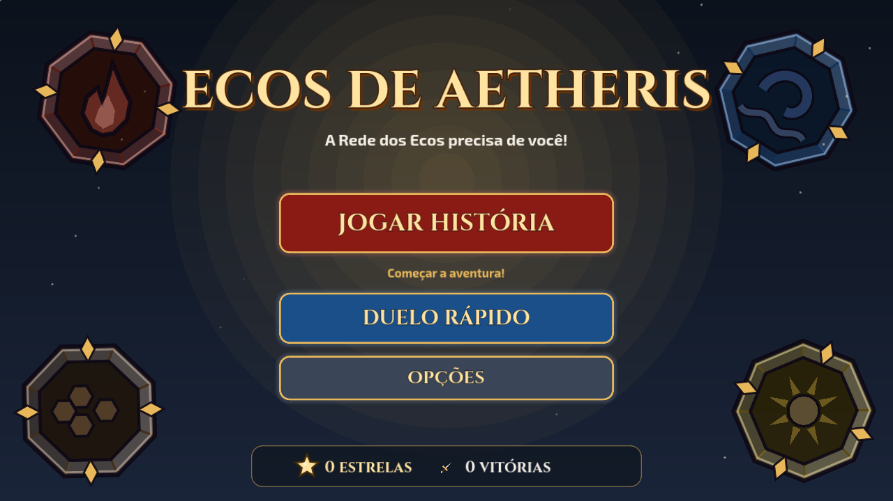
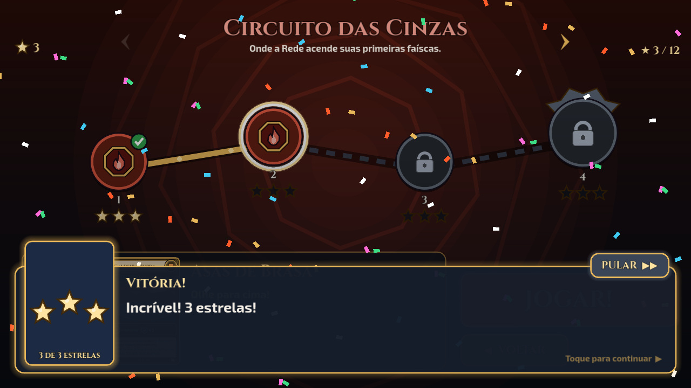
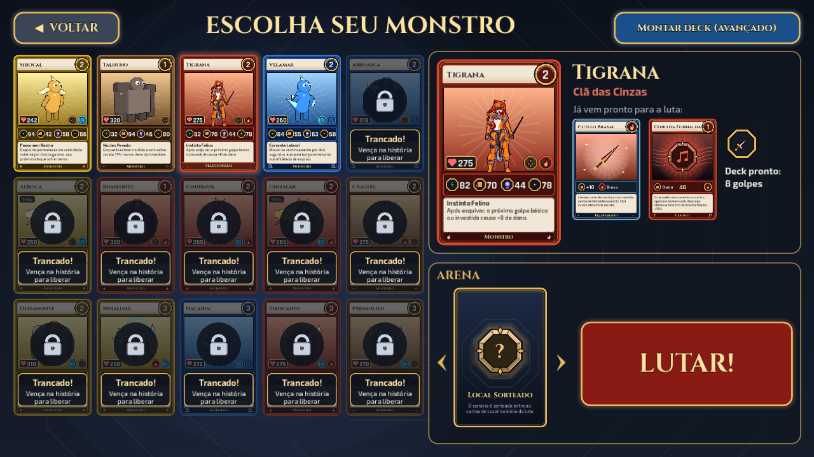
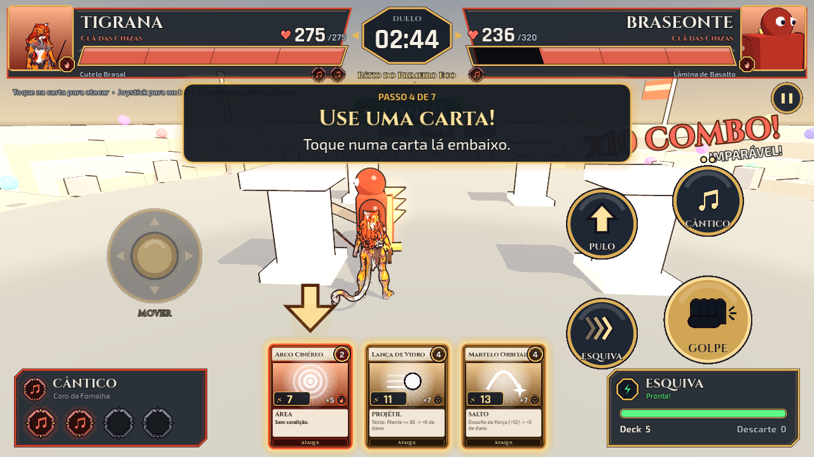
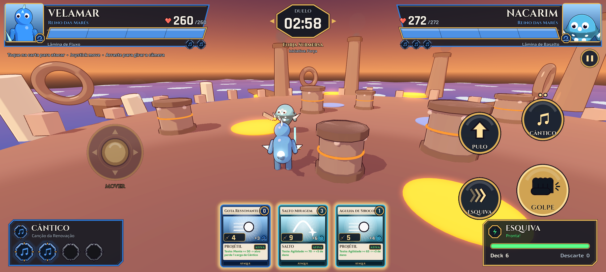
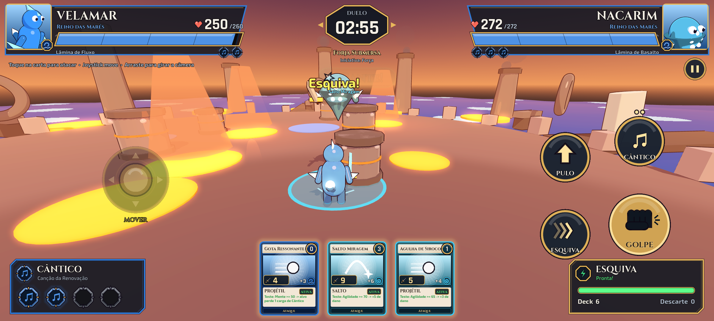
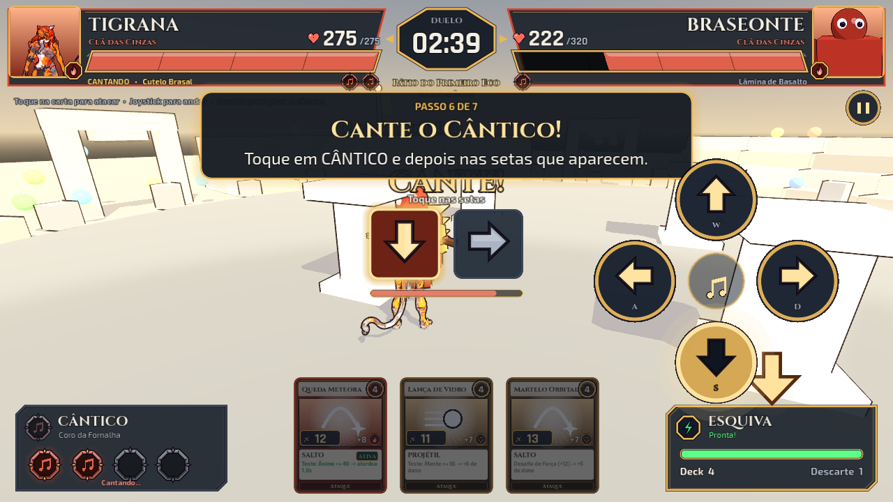
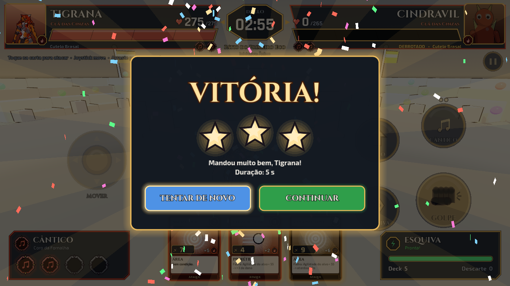
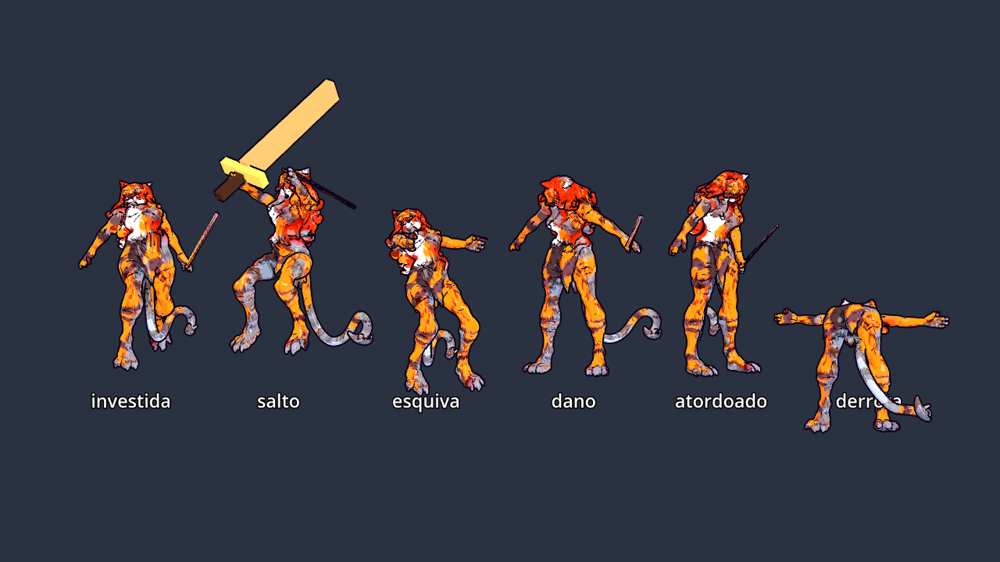
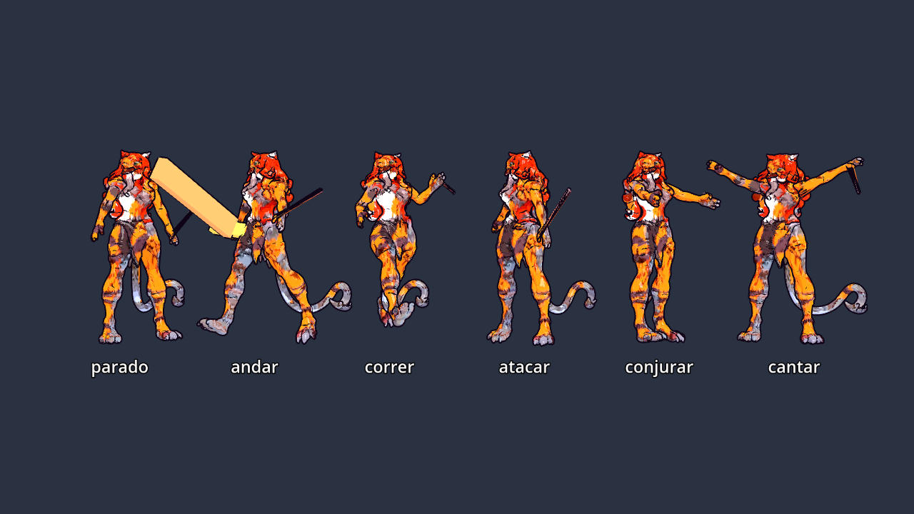

# Ecos de Aetheris: jogo de arena 3D (Godot 4)

Jogo completo (campanha com história, duelo rápido, desktop e celular) construído sobre o conceito em [`../docs/conceito-jogo-3d.md`](../docs/conceito-jogo-3d.md): um jogo de **ação 3D** em que as **cartas são o loadout**, como no anime *Chaotic*. Elas definem o monstro que você controla, o equipamento que ele carrega, o cenário da luta, o Cântico (magia musical) e os golpes que aparecem na sua mão durante o combate.

- Visual: **cel shading de anime com contorno**, cartas e HUD seguindo o conceito de GUI em [`../docs/gui-conceito.md`](../docs/gui-conceito.md).
- Conteúdo: **15 monstros (2 voadores e 1 com modelo 3D riggado), 24 ataques, 8 equipamentos, 6 Cânticos, 11 arenas com cenografia própria e 8 situações de arena** do mundo de Teralume ([`../docs/design-teralume.md`](../docs/design-teralume.md)).
- **Para crianças a partir de 6 anos:** modo fácil ligado por padrão (mira automática, Cântico de 2 notas, inimigos calmos, dicas grandes), tutorial guiado na primeira luta, escolha rápida de monstro, estrelas e recompensas. Tudo em botões grandes, no teclado, no controle ou **na tela de toque**.
- **Campanha:** 5 circuitos de 4 etapas com diálogos, chefes com regras próprias e monstros desbloqueáveis ([`../docs/campanha.md`](../docs/campanha.md)).

> Nomes, monstros, símbolos e textos são **próprios**. Nada usa marca, nomes ou arte de *Chaotic*.

| Título | Mapa da campanha | Escolha rápida | Tutorial (toque) |
|---|---|---|---|
|  |  |  |  |

| Luta no celular (Forja Submersa) | Situação: erupção | Cântico (2 notas no modo fácil) | Vitória com estrelas |
|---|---|---|---|
|  |  |  |  |

## Como rodar

1. Instale o **Godot 4.3** ou mais novo (versão padrão, não precisa da versão .NET): <https://godotengine.org/download>
2. Abra o Godot → **Importar** → selecione `prototipo/project.godot`.
3. Aperte **F5** (ou o botão ▶).

Os monstros e cenários são montados com formas primitivas em código, então não há assets para baixar. A interface tem base **1920x1080** e a janela abre em 1280x720 (redimensione à vontade).

Modos: **JOGAR HISTÓRIA** (campanha; a primeira etapa é o tutorial), **DUELO RÁPIDO** (loadout livre, local sorteado ou escolhido) e **OPÇÕES** (modo fácil, controles de toque, volumes, apagar progresso). O progresso fica em `user://salvo.json`.

## Controles

No celular (ou com "Controles de toque" ligado nas opções) aparecem um **joystick** à esquerda e os botões **GOLPE, ESQUIVA, PULO e CÂNTICO** à direita; as cartas da mão são tocáveis e, durante o Cântico, quatro setas grandes fazem as notas. Arrastar na metade direita gira a câmera.

| Ação | Teclado/mouse | Controle |
|---|---|---|
| Mover | WASD / setas | analógico esquerdo / D-pad |
| Câmera | mouse (Tab trava/destrava no inimigo) | R3 trava |
| Pular (voadores: subir alto) | Espaço | A |
| Esquivar (fica invulnerável por um instante) | Shift | B |
| Golpe básico | clique esquerdo / J | X |
| Cartas de ataque da mão | 1, 2, 3 | LB, Y, RB |
| Cântico | Q, depois a sequência com WASD | RT, depois D-pad |
| Soltar o mouse | Esc | |
| Mostrar controles | F1 | |

No loadout: setas ‹ › (ou clique na carta) trocam a carta. Clique nas cartas de ataque para pôr ou tirar do deck.

## O que está implementado

| Conceito | Como funciona no protótipo |
|---|---|
| **Facções** | Clã das Cinzas, Reino das Marés, Colmeia de Rocha e Nômades da Areia, cada uma com paleta, marca e símbolo de Cântico |
| **Carta de Monstro** | 15 monstros com Agilidade, Força, Mente, Ânimo, Energia, elementos, cargas de Cântico e **passiva própria** (as 12 funcionam na luta). O modelo é montado pela forma (`agil`, `robusto`, `mistico`) mais as peças de silhueta da lista `pecas` |
| **Atributos na ação** | Agilidade → velocidade e recarga da esquiva · Força → golpe básico e resistência a empurrões · Mente → recarga das cartas e força dos Cânticos · Ânimo → crítico e resistência a atordoamento |
| **Deck de ataques** | 6 a 10 cartas, **orçamento de 20 pontos** e **mão de 3** que recarrega após o uso |
| **Arquétipos** | Projétil, Área, Investida e Salto, com aviso no chão, onda de choque e cor do elemento |
| **Desafio / Teste / Falha** | Condições comparando atributos. A carta na mão mostra **ATIVA** (verde) contra o inimigo atual |
| **Equipamento** | Espada, escudo ou amuleto visível no modelo, **oculto até o início da luta** |
| **Cântico** | Cura, dano ou **escudo** (absorve dano por 8 s). Aperte Q e a sequência de 4 teclas (2 no modo fácil, sem perder a carga ao errar); dano interrompe. Monstro da mesma facção do Cântico ganha +15% |
| **Local** | 11 arenas com cenografia própria (vulcão, mar, cristais, arquibancadas, bosque, forja, espiral, tempestade, fenda corrompida), bônus elemental, **iniciativa** (quem vence começa com a mão pronta), lava, água que deixa lento e vento. Pode ser sorteado |
| **Situações** | A cada 20–35 s a arena sorteia um evento (`data/eventos.json`) anunciado com faixa grande e telégrafo: **erupção**, **maré alta**, **tempestade de areia**, **raio**, **desmoronamento**, **rajada**, **falha da Rede** (bônus invertidos e obstáculos que trocam de lugar) e **eco de cura** (quem chega primeiro cura) |
| **Modo fácil** | Golpe com "ímã" e alcance maior, esquiva generosa, menos dano recebido, cartas que miram o alvo, dicas de uma linha, IA que pensa devagar e comemora depois de acertar. Desligável nas opções (a IA então fica normal; chefes ficam difíceis) |
| **Tutorial** | Primeira etapa da campanha: 7 passos (mover, golpe, esquiva, carta, pulo, Cântico, vencer) com painel grande, seta apontando o alvo e inimigo passivo |
| **Campanha** | 5 circuitos (Cinzas, Marés, Mineral, Errante, Convergência) × 4 etapas; diálogos com a mentora Guardiã Lira e com a Voz do Horizonte; chefes com +30% de Energia e regra própria; 1 a 3 estrelas por Energia restante; monstros desbloqueados como recompensa |
| **Toque e celular** | Joystick virtual, botões grandes, cartas e setas tocáveis, vibração, paisagem forçada; presets de exportação para Android, Windows, Linux e Web (`export_presets.cfg`, [`../docs/exportar.md`](../docs/exportar.md)) |
| **Áudio** | Efeitos e músicas sintetizados em código no autoload `Audio` (sem arquivos de som) |
| **Visual anime** | Shader de cel shading em 2 tons com sombra roxa e rim light, contorno de espessura constante, olhos grandes, contador de **combo** ("3 GOLPES – Boa Sequência!") |
| **Interface** | Cartas desenhadas em código (estados normal, hover, selecionada, desabilitada e recarregando), retrato 3D do monstro dentro da carta e na HUD, ícones e símbolos vetoriais. HUD "de desenho animado": barras com faixa de dano recente, combo saltitante, título de episódio na intro, impactos, tremor de câmera e tela de vitória com estrelas e confete |
| **Voo** | Monstros com `"voa": true` (Aerisca, Cinzalar) pairam acima do chão, ignoram lava e água e batem asas. Com Espaço sobem alto por ~2 s: lá em cima só **projéteis** os alcançam (Área, Investida, Salto e golpe básico erram) |
| **Cenário** | Obstáculos **bloqueiam projéteis** (cobertura) e **quebram** com dano (projéteis, Área e Salto). **Capim alto** e **névoa** escondem quem não está atacando: projéteis não perseguem e a IA perde você de vista |
| **IA** | Mantém a distância certa para as cartas da mão. Se o monstro dela é **mais rápido**, faz kiting (ataca de longe, recua, esquiva investidas e não se deixa encurralar). Espera recarga **atrás de obstáculos** ou no capim, não atira em pilar no caminho, caça quem se escondeu, sobe quando é voadora e contra voadores no alto usa só projéteis. Também interrompe Cânticos, usa escudo e evita lava |

## Criar ou alterar conteúdo

Tudo fica em `data/*.json`, sem mexer em código:

- `faccoes.json`: cores e marca (`chamas`, `onda`, `colmeia`, `sol`)
- `monstros.json`: atributos, energia, elementos, `faccao`, `forma`, `voa` (opcional), `pecas` (silhueta) e `passiva`
  - Peças disponíveis: `chifres`, `chifres_frente`, `crista`, `cauda`, `cauda_cones`, `barbatanas_ombro`, `barbatanas_braco`, `placas_costas`, `punhos`, `casco`, `ombreiras_cone`, `ombreiras_bloco`, `ombreiras_esfera`, `ombreiras_inclinadas`, `nucleo`, `ornamentos`, `nos_perola`, `cristais`, `laminas_laterais`, `aureola`, `manto` e `asas` (batem quando o monstro voa)
- `ataques.json`: `custo`, `arquetipo`, `dano_base`, `bonus_elemento`, `velocidade`, `tamanho` (em Área e Salto, o raio é `tamanho` × 2,2) e `condicao`:
  ```json
  "condicao": {"tipo": "desafio", "atributo": "agilidade", "margem": 1,
               "efeito": {"tipo": "atordoar", "valor": 0.6}}
  ```
  Efeitos: `dano_extra`, `atordoar` (segundos), `empurrar` (força de 1 a 10), `cura` e `roubar_carga`.
- `equipamentos.json`, `canticos.json` (`cura`/`dano`/`escudo`) e `locais.json`
  - `perigos` dos locais: `lava` (dano), `agua` (lentidão), `mato` (capim alto que esconde) e `nevoa` (névoa que esconde). Os `obstaculos` `[x, z, raio, altura]` viram cobertura destrutível; `estilo_obstaculo`: `rocha`, `pilar`, `arvore`, `cristal`, `metal`, `corrompido`
  - `tema` escolhe a cenografia (`scripts/cenario.gd`), `eventos` lista as situações possíveis, e os opcionais `vento_constante`, `nevoa_movel`, `corrompido` (obstáculos que somem e voltam) e `chefe`
- `eventos.json`: as situações de arena (`nome`, `dica`, `cor`, `icone`, `aviso`, `duracao` e os números de cada uma)
- `campanha.json`: circuitos e etapas (`titulo`, `frase`, `local`, `inimigo`, falas `antes`/`vitoria`/`derrota`, `recompensa`, `chefe`, `regra`, `energia_bonus`)

**Arte final das cartas:** salve `arte/cartas/<id>.png` e ela substitui a arte procedural automaticamente.

## Modelos 3D próprios (GLB riggado)

Um monstro pode usar um modelo 3D no lugar das formas primitivas: basta o campo `"modelo"` no `monstros.json` (exemplo: a **Tigrana**, `modelos/tigrana/tigrana.glb`). O jogo:

- aplica o cel shading e o contorno usando as **cores de vértice** do modelo;
- toca as animações conforme o estado: `parado`, `andar`, `correr`, `atacar` (golpe básico), `conjurar` (projétil e área), `investida`, `salto`, `esquiva`, `cantar`, `dano`, `atordoado` e `derrota`;
- prende o equipamento nos ossos `Hand.R`, `Hand.L` e `Chest`;
- mostra o modelo animado (respirando) na carta e no retrato da HUD.

| Animações da Tigrana | |
|---|---|
|  |  |

Se o GLB tiver outros nomes (Mixamo, AccuRig etc.), mapeie no JSON:
```json
"animacoes": {"parado": "Idle", "correr": "Running", "atacar": "Punch"},
"ossos": {"mao_dir": "mixamorig:RightHand", "mao_esq": "mixamorig:LeftHand", "peito": "mixamorig:Spine2"}
```

### Rig automático de um modelo gerado por IA

`ferramentas/riggar_modelo.py` transforma um GLB **só com geometria** (como o do Hunyuan3D) num personagem pronto para o jogo. Ele usa o Blender como módulo Python (`pip install bpy`, Python 3.13). O modelo de entrada deve estar em **pose T** (braços abertos, sem encostar no corpo):

```bash
# pintura copiada de uma versão anterior já riggada da mesma personagem
python ferramentas/riggar_modelo.py ferramentas/tigrana_pose_t.glb ferramentas/tigrana_pintura_v1.glb modelos/tigrana/tigrana.glb
# ou pintura projetada de uma imagem de referência (vista de frente)
python ferramentas/riggar_modelo.py entrada.glb referencia.png modelos/nome/nome.glb
```

1. Centraliza a malha e subdivide uma vez (mais resolução para a pintura).
2. Cria o **esqueleto**: tronco, braços, pernas e 7 ossos de cauda, nas posições da tabela `JUNTAS` (medidas por fatias da malha; para outro modelo, meça e troque a tabela).
3. Calcula **pesos automáticos** (difusão de calor do Blender), com cada braço limitado a um tubo em volta dos seus ossos.
4. **Abaixa os braços** (pose T → pose A) e grava essa pose como repouso, que é a que as animações esperam.
5. **Pinta** cores de vértice: copiadas de um GLB riggado anterior (cada vértice é levado pelo seu osso até o outro modelo e pega a cor do vértice mais próximo da mesma região) ou projetadas da imagem de referência. O cabelo (vermelho) fica preso à cabeça e ao peito.
6. Gera as 12 **animações** e exporta o GLB.

`ferramentas/tigrana_pintura_v1.glb` é a primeira versão da Tigrana (malha com os braços colados), mantida só como fonte da pintura.

### Vistas para pintura externa

`ferramentas/renderizar_vistas.py entrada.glb pasta` renderiza a malha crua (argila cinza) de frente, costas e laterais, em câmera ortográfica com enquadramento fixo (`enquadramento.json`). As vistas da Tigrana em pose T estão em `ferramentas/vistas_tigrana/`: servem para pintar num gerador de imagem e depois projetar a pintura de volta no modelo.

## Simular partidas e roteiros de teste

```bash
godot --headless --path prototipo --fixed-fps 60 -- --simular=96
godot --path prototipo -- --tela=batalha --roteiro=/caminho/roteiro.gd --pasta=/caminho/capturas
```

`--simular=N` roda partidas **IA contra IA** (dificuldade normal) sem janela e imprime as vitórias de cada monstro; `--autoteste` roda só uma. `--roteiro` carrega um script (`extends Node`) que dirige o jogo com a classe `Depuracao` (esperar, capturar a tela, apertar ações, simular toques); `--tela` abre direto em `titulo`, `loadout`, `campanha`, `opcoes` ou `batalha`. As linhas `Parameter "m" is null` (mesh_storage.h) são ruído do renderizador vazio do modo headless e podem ser ignoradas.

## Estrutura

```
prototipo/
├── project.godot          # Godot 4.3, renderizador Compatibility, base 1920x1080
├── main.tscn              # cena raiz; o resto é montado por código
├── data/*.json            # cartas, facções, eventos de arena e campanha
├── export_presets.cfg     # Android, Windows, Linux e Web
├── fontes/                # Cinzel, Rajdhani e Exo 2 (licença OFL)
├── shaders/
│   ├── toon.gdshader      # cel shading de anime
│   └── contorno.gdshader  # contorno por casco invertido
└── scripts/
    ├── dados.gd           # autoload: JSON, facções, deck sugerido, controles e tema
    ├── jogo.gd            # autoload: configurações, progresso, campanha e salvamento
    ├── audio.gd           # autoload: efeitos e músicas sintetizados em código
    ├── main.gd            # título → campanha/duelo → loadout → batalha; simulação e roteiros
    ├── loadout.gd         # escolha rápida e montagem de deck avançada
    ├── batalha.gd         # arena, perigos, intro, iniciativa, eventos, fim da partida
    ├── cenario.gd         # cenografia por tema e estilos de obstáculo
    ├── eventos_arena.gd   # situações durante a luta
    ├── tutorial.gd        # primeira luta guiada em 7 passos
    ├── controle_toque.gd  # joystick e botões de toque
    ├── depuracao.gd       # utilidades para roteiros de teste e captura
    ├── lutador.gd         # o monstro: atributos, ações, passivas, Cântico, modelo
    ├── mao_cartas.gd      # deck/mão de 3/descarte/recarga
    ├── combate.gd         # dano, Desafio/Teste/Falha, efeitos
    ├── projetil.gd, efeitos.gd, camera_orbita.gd
    ├── controle_jogador.gd, controle_ia.gd
    ├── hud.gd             # HUD da luta e tela de resultado
    └── ui/
        ├── menu_titulo.gd     # tela de título
        ├── campanha.gd        # mapa dos circuitos
        ├── dialogo.gd         # caixa de diálogo da história
        ├── opcoes.gd          # opções
        ├── tema.gd            # paleta, fontes, estilos
        ├── icones.gd          # atributos, elementos, símbolos de Cântico, emblemas
        ├── carta_visual.gd    # a carta (todos os tipos e estados)
        ├── retrato_monstro.gd # monstro 3D renderizado numa textura
        ├── painel_lutador.gd  # barra de Energia com retrato
        └── desenho.gd         # Control genérico que desenha via Callable
```

## Exportar

Os presets de `export_presets.cfg` já incluem `*.json` nos filtros. O passo a passo para Android, Windows, Linux e Web (templates, keystore, teste no celular) está em [`../docs/exportar.md`](../docs/exportar.md).

## Próximos passos sugeridos

1. Jogar e ajustar a sensação (velocidade, recarga, dano) e o balanceamento no modo normal.
2. Arte das cartas (`arte/cartas/<id>.png`) e modelos `.glb` pintados no lugar das primitivas.
3. Tabuleiro tático 3x3 entre as lutas e exploração com escaneamento de Ecos (ver `design-teralume.md`).
4. Regras de chefe além da Energia extra (hoje são texto de sabor).
